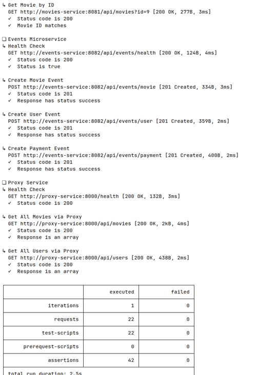
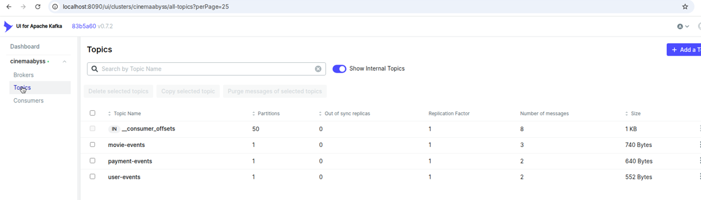
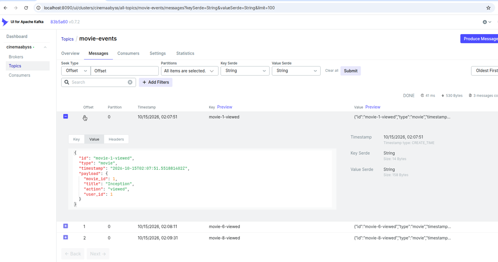
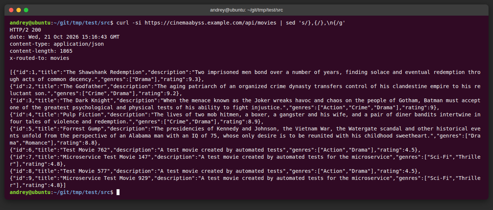
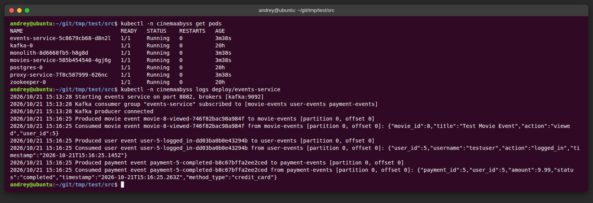
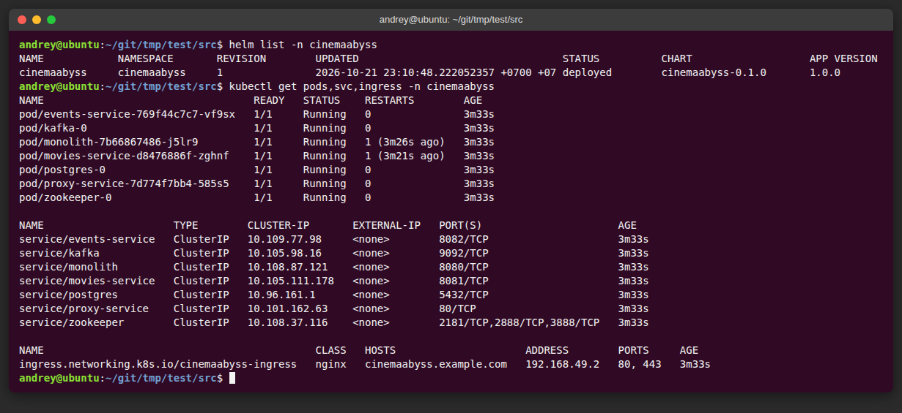
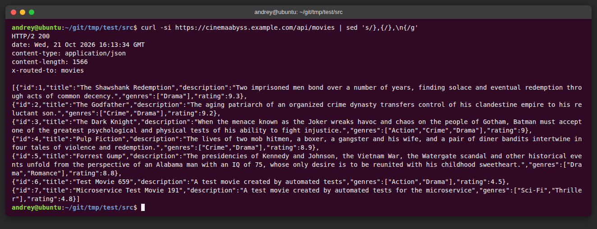
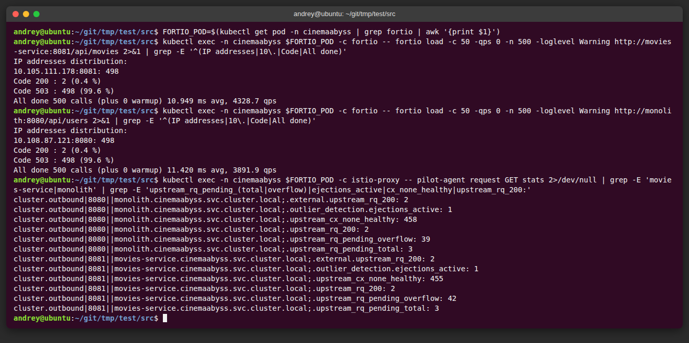

## Изучите [README.md](README.md) файл и структуру проекта.

## Задание 1

1. Спроектируйте to be архитектуру КиноБездны, разделив всю систему на отдельные домены и организовав интеграционное взаимодействие и единую точку вызова сервисов.
Результат представьте в виде контейнерной диаграммы в нотации С4.
Добавьте ссылку на файл в этот шаблон

### Решение

[C4 Container](docs/cinemaabyss-tobe-containers.puml)

Целевая система заменяет монолит шестью доменными сервисами. У каждого своя схема PostgreSQL, общая база не используется. Клиенты (веб, мобильное приложение, Smart TV) ходят только в API Gateway: это единственная точка вызова.

Домены совпадают с предметными областями из описания продукта:

| Домен | Ответственность | Данные |
| --- | --- | --- |
| Users | Регистрация, вход, профиль, папки избранного | users, избранное |
| Movies | Метаданные: описание, жанры, актёры, оценки | movies, genres, ratings |
| Video | Ссылка на поток, хранение и факт просмотра | ссылки на внешние потоки, файлы в объектном хранилище, прогресс |
| Subscriptions | Тариф и срок подписки | subscriptions |
| Payments | Списание и статус транзакции | payments |
| Discounts | Скидки и промокоды | правила скидок |

Избранное остаётся в Users: это данные зрителя, а не каталога. Оценки остаются в Movies, потому что в текущей модели они часть метаданных фильма. Video отделён от Movies: метаданные и поток меняются по разным причинам. Сам сервис хранит в PostgreSQL только ссылки и прогресс; собственные и кэшированные видеофайлы размещаются в объектном хранилище и раздаются через CDN. Внешний контент Video получает через API стриминговых сервисов и открытых источников.

### Интеграция

Синхронный REST используется там, где клиенту нужен ответ сразу. Gateway маршрутизирует запрос и подстраивает размер ответа под тип устройства. Перед выдачей потока gateway проверяет подписку. Payments синхронно спрашивает Discounts сумму до обращения к платёжному провайдеру.

Остальные связи между доменами асинхронные, через Kafka:

- Users публикует `user.registered` и `user.logged_in`.
- Movies публикует `movie.added` и `movie.rated`.
- Video публикует `movie.viewed`.
- Payments публикует `payment.succeeded` и `payment.failed`.
- Subscriptions подписывается на `payment.succeeded` и открывает или продлевает подписку.
- Рекомендательная система подписана на просмотры и оценки. Gateway забирает у неё готовую подборку по REST.

Сервис `events` из репозитория — не отдельный домен. Это переходный способ записать события user, movie и payment в Kafka. В целевой схеме те же топики публикуют доменные сервисы.

Монолита в целевой схеме нет. Пока идёт перенос, gateway оставляет его за собой и переключает трафик по фиче-флагу (Strangler Fig): сначала movies, затем остальные домены. Развёртывание — Kubernetes, наружу смотрит только ingress перед gateway.


## Задание 2

### 1. Proxy
Команда КиноБездны уже выделила сервис метаданных о фильмах movies и вам необходимо реализовать бесшовный переход с применением паттерна Strangler Fig в части реализации прокси-сервиса (API Gateway), с помощью которого можно будет постепенно переключать траффик, используя фиче-флаг.


Реализуйте сервис на любом языке программирования в ./src/microservices/proxy.
Конфигурация для запуска сервиса через docker-compose уже добавлена
```yaml
  proxy-service:
    build:
      context: ./src/microservices/proxy
      dockerfile: Dockerfile
    container_name: cinemaabyss-proxy-service
    depends_on:
      - monolith
      - movies-service
      - events-service
    ports:
      - "8000:8000"
    environment:
      PORT: 8000
      MONOLITH_URL: http://monolith:8080
      #монолит
      MOVIES_SERVICE_URL: http://movies-service:8081 #сервис movies
      EVENTS_SERVICE_URL: http://events-service:8082 
      GRADUAL_MIGRATION: "true" # вкл/выкл простого фиче-флага
      MOVIES_MIGRATION_PERCENT: "50" # процент миграции
    networks:
      - cinemaabyss-network
```

- После реализации запустите postman тесты - они все должны быть зеленые.
- Отправьте запросы к API Gateway:
   ```bash
   curl http://localhost:8000/api/movies
   ```
- Протестируйте постепенный переход, изменив переменную окружения MOVIES_MIGRATION_PERCENT в файле docker-compose.yml.

#### Решение

Прокси написан на Go без внешних зависимостей: [src/microservices/proxy](src/microservices/proxy/main.go).

Запрос в `/api/movies` уходит в movies с вероятностью `MOVIES_MIGRATION_PERCENT`, иначе в монолит

- `GRADUAL_MIGRATION: "true"` включает постепенный переход по проценту.
- `GRADUAL_MIGRATION: "false"` отправляет весь домен movies в новый сервис, как описано в README.
- Процент ограничен диапазоном 0–100; некорректное значение считается за 0, и трафик остаётся в монолите.

Прокси пишет в лог маршрут каждого запроса и добавляет заголовок `X-Routed-To` (`monolith`, `movies` или `events`). По этому заголовку видно, куда попал запрос:

```bash
for i in $(seq 1 200); do
  curl -s -o /dev/null -D - http://localhost:8000/api/movies | grep -i x-routed-to
done | sort | uniq -c
```

| `MOVIES_MIGRATION_PERCENT` | Результат |
| --- | --- |
| `0` | 50 из 50 — monolith |
| `50` | 97 из 200 — movies, 103 — monolith |
| `100` | 50 из 50 — movies |

### 2. Kafka
 Вам как архитектуру нужно также проверить гипотезу насколько просто реализовать применение Kafka в данной архитектуре.

Для этого нужно сделать MVP сервис events, который будет при вызове API создавать и сам же читать сообщения в топике Kafka.

    - Разработайте сервис на любом языке программирования с consumer'ами и producer'ами.
    - Реализуйте простой API, при вызове которого будут создаваться события User/Payment/Movie и обрабатываться внутри сервиса с записью в лог
    - Добавьте в docker-compose новый сервис, kafka там уже есть

Необходимые тесты для проверки этого API вызываются при запуске npm run test:local из папки tests/postman 
Приложите скриншот тестов и скриншот состояния топиков Kafka http://localhost:8090 

#### Решение

Сервис events также написан на Go, с библиотекой [IBM/sarama](https://github.com/IBM/sarama).

| Эндпоинт | Топик |
| --- | --- |
| `POST /api/events/movie` | `movie-events` |
| `POST /api/events/user` | `user-events` |
| `POST /api/events/payment` | `payment-events` |

- Producer синхронный: ответ `201` возвращается только после подтверждения от Kafka. В ответе — партиция, смещение и само событие, как в `EventResponse` из спецификации.
- Consumer group `events-service` читает все три топика и пишет каждое событие в лог сервиса.
- Обязательные поля проверяются по спецификации; при ошибке сервис отвечает `400`.
- Kafka в docker-compose поднимается дольше сервиса, поэтому producer и consumer переподключаются раз в 3 секунды. Пока Kafka недоступна, POST отвечает `503`, health-check — `200`.

Лог сервиса после прогона тестов:

```
Produced movie event movie-6-viewed to movie-events [partition 0, offset 1]
Consumed movie event movie-6-viewed from movie-events [partition 0, offset 1]: {"movie_id":6,"title":"Test Movie Event","action":"viewed","user_id":4}
Produced user event user-4-logged_in to user-events [partition 0, offset 0]
Consumed user event user-4-logged_in from user-events [partition 0, offset 0]: {"user_id":4,"username":"testuser","action":"logged_in","timestamp":"2026-10-15T02:08:11.381Z"}
Produced payment event payment-4-completed to payment-events [partition 0, offset 0]
Consumed payment event payment-4-completed from payment-events [partition 0, offset 0]: {"payment_id":4,"user_id":4,"amount":9.99,"status":"completed","timestamp":"2026-10-15T02:08:11.498Z","method_type":"credit_card"}
```

В `docker-compose.yml` монолит и movies теперь ждут, пока Postgres пройдёт health-check: при одновременном старте оба падали с `connection refused`. У events убрана зависимость от Postgres — база ему не нужна.

Postman-тесты: 22 запроса, 42 проверки, 0 ошибок.



Топики Kafka в Kafka UI:



Сообщения в топике `movie-events`:




## Задание 3

Команда начала переезд в Kubernetes для лучшего масштабирования и повышения надежности. 
Вам, как архитектору осталось самое сложное:
 - реализовать CI/CD для сборки прокси сервиса
 - реализовать необходимые конфигурационные файлы для переключения трафика.


### CI/CD

 В папке .github/worflows доработайте деплой новых сервисов proxy и events в docker-build-push.yml , чтобы api-tests при сборке отрабатывали корректно при отправке коммита в вашу новую ветку.

Нужно доработать 
```yaml
on:
  push:
    branches: [ main ]
    paths:
      - 'src/**'
      - '.github/workflows/docker-build-push.yml'
  release:
    types: [published]
```
и добавить необходимые шаги в блок
```yaml
jobs:
  build-and-push:
    runs-on: ubuntu-latest
    permissions:
      contents: read
      packages: write

    steps:
      - name: Checkout repository
        uses: actions/checkout@v3

      - name: Set up Docker Buildx
        uses: docker/setup-buildx-action@v2

      - name: Log in to the Container registry
        uses: docker/login-action@v2
        with:
          registry: ${{ env.REGISTRY }}
          username: ${{ github.actor }}
          password: ${{ secrets.GITHUB_TOKEN }}

```
Как только сборка отработает и в github registry появятся ваши образы, можно переходить к блоку настройки Kubernetes
Успешным результатом данного шага является "зеленая" сборка и "зеленые" тесты

#### Решение

- В [docker-build-push.yml](.github/workflows/docker-build-push.yml) добавлена сборка и публикация образов `events-service` и `proxy-service` — по тому же шаблону, что monolith и movies.
- Оба workflow запускаются на push в рабочую ветку `cinema` (и в `main`); `api-tests` — ещё и на каждый pull request.
- При push образы публикуются в `ghcr.io/mcxinus/architecture-pro-cinemaabyss/<сервис>` с тегами `latest`, short sha и именем ветки.
- Кнопка «Run workflow» для `workflow_dispatch` в интерфейсе GitHub есть только у workflow из ветки по умолчанию (`main`), поэтому основной способ запустить сборку — push в рабочую ветку.


### Proxy в Kubernetes

#### Шаг 1
Для деплоя в kubernetes необходимо залогиниться в docker registry Github'а.
1. Создайте Personal Access Token (PAT) https://github.com/settings/tokens . Создавайте class с правом read:packages
2. В src/kubernetes/*.yaml (event-service, monolith, movies-service и proxy-service)  отредактируйте путь до ваших образов 
```bash
 spec:
      containers:
      - name: events-service
        image: ghcr.io/ваш логин/имя репозитория/events-service:latest
```
3. Добавьте в секрет src/kubernetes/dockerconfigsecret.yaml в поле
```bash
 .dockerconfigjson: значение в base64 файла ~/.docker/config.json
```

4. Если в ~/.docker/config.json нет значения для аутентификации
```json
{
        "auths": {
                "ghcr.io": {
                       тут пусто
                }
        }
}
```
то выполните 

и добавьте

```json 
 "auth": "имя пользователя:токен в base64"
```

Чтобы получить значение в base64 можно выполнить команду
```bash
 echo -n ваш_логин:ваш_токен | base64
```

После заполнения config.json, также прогоните содержимое через base64

```bash
cat .docker/config.json | base64
```

и полученное значение добавляем в

```bash
 .dockerconfigjson: значение в base64 файла ~/.docker/config.json
```

#### Шаг 2

  Доработайте src/kubernetes/event-service.yaml и src/kubernetes/proxy-service.yaml

  - Необходимо создать Deployment и Service 
  - Доработайте ingress.yaml, чтобы можно было с помощью тестов проверить создание событий
  - Выполните дальшейшие шаги для поднятия кластера:

  1. Создайте namespace:
  ```bash
  kubectl apply -f src/kubernetes/namespace.yaml
  ```
  2. Создайте секреты и переменные
  ```bash
  kubectl apply -f src/kubernetes/configmap.yaml
  kubectl apply -f src/kubernetes/secret.yaml
  kubectl apply -f src/kubernetes/dockerconfigsecret.yaml
  kubectl apply -f src/kubernetes/postgres-init-configmap.yaml
  ```

  3. Разверните базу данных:
  ```bash
  kubectl apply -f src/kubernetes/postgres.yaml
  ```

  На этом этапе если вызвать команду
  ```bash
  kubectl -n cinemaabyss get pod
  ```
  Вы увидите

  NAME         READY   STATUS    
  postgres-0   1/1     Running   

  4. Разверните Kafka:
  ```bash
  kubectl apply -f src/kubernetes/kafka/kafka.yaml
  ```

  Проверьте, теперь должно быть запущено 3 пода, если что-то не так, то посмотрите логи
  ```bash
  kubectl -n cinemaabyss logs имя_пода (например - kafka-0)
  ```

  5. Разверните монолит:
  ```bash
  kubectl apply -f src/kubernetes/monolith.yaml
  ```
  6. Разверните микросервисы:
  ```bash
  kubectl apply -f src/kubernetes/movies-service.yaml
  kubectl apply -f src/kubernetes/events-service.yaml
  ```
  7. Разверните прокси-сервис:
  ```bash
  kubectl apply -f src/kubernetes/proxy-service.yaml
  ```

  После запуска и поднятия подов вывод команды 
  ```bash
  kubectl -n cinemaabyss get pod
  ```

  Будет наподобие такого

  NAME                              READY   STATUS    

  events-service-7587c6dfd5-6whzx   1/1     Running  

  kafka-0                           1/1     Running   

  monolith-8476598495-wmtmw         1/1     Running  

  movies-service-6d5697c584-4qfqs   1/1     Running  

  postgres-0                        1/1     Running  

  proxy-service-577d6c549b-6qfcv    1/1     Running  

  zookeeper-0                       1/1     Running 

  8. Добавим ingress

  - добавьте аддон
  ```bash
  minikube addons enable ingress
  ```
  Создайте локальный TLS-сертификат и Secret (ключи не хранятся в репозитории):
  ```bash
  openssl req -x509 -nodes -days 30 -newkey rsa:2048 \
    -keyout /tmp/cinemaabyss.key -out /tmp/cinemaabyss.crt \
    -subj "/CN=cinemaabyss.example.com" \
    -addext "subjectAltName=DNS:cinemaabyss.example.com"
  kubectl -n cinemaabyss create secret tls cinemaabyss-tls \
    --key /tmp/cinemaabyss.key --cert /tmp/cinemaabyss.crt
  ```
  ```bash
  kubectl apply -f src/kubernetes/ingress.yaml
  ```
  9. Добавьте в /etc/hosts
  127.0.0.1 cinemaabyss.example.com

  10. Вызовите
  ```bash
  minikube tunnel
  ```
  11. Вызовите https://cinemaabyss.example.com/api/movies
  Вы должны увидеть вывод списка фильмов
  Можно поэкспериментировать со значением   MOVIES_MIGRATION_PERCENT в src/kubernetes/configmap.yaml и убедится, что вызовы movies уходят полностью в новый сервис

  12. Запустите тесты из папки tests/postman
  ```bash
   npm run test:kubernetes
  ```
  Часть тестов с health-чек упадет, но создание событий отработает.
  Откройте логи event-service и сделайте скриншот обработки событий

#### Решение шагов 1–2

- Образы в `monolith.yaml`, `movies-service.yaml`, `events-service.yaml` и `proxy-service.yaml` указывают на `ghcr.io/mcxinus/architecture-pro-cinemaabyss/...`.
- [events-service.yaml](src/kubernetes/events-service.yaml): Deployment и Service на порту 8082. Kafka задана как `kafka:9092`; readiness проверяет Kafka через `/api/events/health`, а liveness проверяет процесс через `/health`.
- [proxy-service.yaml](src/kubernetes/proxy-service.yaml): Deployment и Service на порту 8000. Адреса сервисов и настройки миграции берутся из `cinemaabyss-config`, health-check — `/health`.
- В [configmap.yaml](src/kubernetes/configmap.yaml) добавлен `EVENTS_SERVICE_URL`.
- В [ingress.yaml](src/kubernetes/ingress.yaml) HTTPS-трафик направляется только в `proxy-service:8000`, поэтому API Gateway остаётся единой внешней точкой входа.
- `dockerconfigsecret.yaml` содержит валидную анонимную конфигурацию для публичных GHCR-образов. Для приватных образов её нужно заменить по инструкции из шага 1; токен в репозиторий не коммитится.

#### Шаг 3
Добавьте сюда скриншота вывода при вызове https://cinemaabyss.example.com/api/movies и  скриншот вывода event-service после вызова тестов.

#### Решение шага 3

Кластер поднят в minikube (драйвер docker) по шагам выше, все поды в статусе `Running`. Ingress-контроллер minikube на драйвере docker доступен напрямую по `minikube ip`, поэтому вместо `127.0.0.1` + `minikube tunnel` домен `cinemaabyss.example.com` можно направить на этот адрес.

`npm run test:kubernetes`: 22 запроса, 42 проверки, 0 ошибок.

Вызов https://cinemaabyss.example.com/api/movies — при `MOVIES_MIGRATION_PERCENT: "100"` запрос уходит в movies (`x-routed-to: movies`):



Логи events-service после прогона тестов — события movie, user и payment записаны в Kafka и прочитаны consumer'ом:




## Задание 4
Для простоты дальнейшего обновления и развертывания вам как архитектуру необходимо так же реализовать helm-чарты для прокси-сервиса и проверить работу 

Для этого:
1. Перейдите в директорию helm и отредактируйте файл values.yaml

```yaml
# Proxy service configuration
proxyService:
  enabled: true
  image:
    repository: ghcr.io/db-exp/cinemaabysstest/proxy-service
    tag: latest
    pullPolicy: Always
  replicas: 1
  resources:
    limits:
      cpu: 300m
      memory: 256Mi
    requests:
      cpu: 100m
      memory: 128Mi
  service:
    port: 80
    targetPort: 8000
    type: ClusterIP
```

- Вместо ghcr.io/db-exp/cinemaabysstest/proxy-service напишите свой путь до образа для всех сервисов
- для imagePullSecret проставьте свое значение (скопируйте из конфигурации kubernetes)
  ```yaml
  imagePullSecrets:
      dockerconfigjson: ewoJImF1dGhzIjogewoJCSJnaGNyLmlvIjogewoJCQkiYXV0aCI6ICJaR0l0Wlhod09tZG9jRjl2UTJocVZIa3dhMWhKVDIxWmFVZHJOV2hRUW10aFVXbFZSbTVaTjJRMFNYUjRZMWM9IgoJCX0KCX0sCgkiY3JlZHNTdG9yZSI6ICJkZXNrdG9wIiwKCSJjdXJyZW50Q29udGV4dCI6ICJkZXNrdG9wLWxpbnV4IiwKCSJwbHVnaW5zIjogewoJCSIteC1jbGktaGludHMiOiB7CgkJCSJlbmFibGVkIjogInRydWUiCgkJfQoJfSwKCSJmZWF0dXJlcyI6IHsKCQkiaG9va3MiOiAidHJ1ZSIKCX0KfQ==
  ```

2. В папке ./templates/services заполните шаблоны для proxy-service.yaml и events-service.yaml (опирайтесь на свою kubernetes конфигурацию - смысл helm'а сделать шаблоны для быстрого обновления и установки)

```yaml
template:
    metadata:
      labels:
        app: proxy-service
    spec:
      containers:
       Тут ваша конфигурация
```

3. Проверьте установку
Сначала удалим установку руками

```bash
kubectl delete all --all -n cinemaabyss
kubectl delete  namespace cinemaabyss
```
Запустите 
```bash
helm install cinemaabyss .\src\kubernetes\helm --namespace cinemaabyss --create-namespace
```
Если в процессе будет ошибка
```code
[2025-04-08 21:43:38,780] ERROR Fatal error during KafkaServer startup. Prepare to shutdown (kafka.server.KafkaServer)
kafka.common.InconsistentClusterIdException: The Cluster ID OkOjGPrdRimp8nkFohYkCw doesn't match stored clusterId Some(sbkcoiSiQV2h_mQpwy05zQ) in meta.properties. The broker is trying to join the wrong cluster. Configured zookeeper.connect may be wrong.
```

Проверьте развертывание:
```bash
kubectl get pods -n cinemaabyss
minikube tunnel
```

Потом вызовите 
https://cinemaabyss.example.com/api/movies
и приложите скриншот развертывания helm и вывода https://cinemaabyss.example.com/api/movies

#### Решение

- [proxy-service.yaml](src/kubernetes/helm/templates/services/proxy-service.yaml) и [events-service.yaml](src/kubernetes/helm/templates/services/events-service.yaml) повторяют конфигурацию из задания 3, но образ, порты, ресурсы и число реплик берутся из `values.yaml`. Service прокси слушает порт 80 и проксирует на 8000. Под прокси перезапускается при изменении ConfigMap (аннотация `checksum/config`), поэтому `MOVIES_MIGRATION_PERCENT` можно менять через `helm upgrade --set config.moviesMigrationPercent=...`.
- В [values.yaml](src/kubernetes/helm/values.yaml) образы указывают на `ghcr.io/mcxinus/architecture-pro-cinemaabyss/...`.
- Исправлен ConfigMap чарта: адрес movies был `http://movies:8081` вместо `http://movies-service:8081`, а `EVENTS_SERVICE_URL` отсутствовал.
- Ingress, как и в задании 3, направляет весь трафик только в `proxy-service`. Аннотация `kubernetes.io/ingress.class` удалена: Kubernetes не принимает её вместе с `ingressClassName`. Добавлены TLS и редирект с HTTP на HTTPS; чарт сам генерирует самоподписанный сертификат на 30 дней при первой установке (`ingress.tls.selfSigned`), ключи в репозитории не хранятся.
- В `values.yaml` для `imagePullSecrets.dockerconfigjson` лежит пустая конфигурация `{"auths":{}}`, реальный токен передаётся при установке:

```bash
helm install cinemaabyss src/kubernetes/helm --namespace cinemaabyss --create-namespace \
  --set imagePullSecrets.dockerconfigjson=$(base64 -w0 ~/.docker/config.json)
```

`npm run test:kubernetes` на установке через helm: 22 запроса, 42 проверки, 0 ошибок. Monolith и movies один раз перезапускаются при старте, пока Postgres не готов.

Развертывание helm:



Вызов https://cinemaabyss.example.com/api/movies:




# Задание 5
Компания планирует активно развиваться и для повышения надежности, безопасности, реализации сетевых паттернов типа Circuit Breaker и канареечного деплоя вам как архитектору необходимо развернуть istio и настроить circuit breaker для monolith и movies сервисов.

```bash

helm repo add istio https://istio-release.storage.googleapis.com/charts
helm repo update

helm install istio-base istio/base -n istio-system --set defaultRevision=default --create-namespace
helm install istio-ingressgateway istio/gateway -n istio-system
helm install istiod istio/istiod -n istio-system --wait

helm install cinemaabyss .\src\kubernetes\helm --namespace cinemaabyss --create-namespace

kubectl label namespace cinemaabyss istio-injection=enabled --overwrite

kubectl get namespace -L istio-injection

kubectl apply -f .\src\kubernetes\circuit-breaker-config.yaml -n cinemaabyss

```

Тестирование

# fortio
```bash
kubectl apply -f https://raw.githubusercontent.com/istio/istio/release-1.25/samples/httpbin/sample-client/fortio-deploy.yaml -n cinemaabyss
```

# Get the fortio pod name
```bash
FORTIO_POD=$(kubectl get pod -n cinemaabyss | grep fortio | awk '{print $1}')

kubectl exec -n cinemaabyss $FORTIO_POD -c fortio -- fortio load -c 50 -qps 0 -n 500 -loglevel Warning http://movies-service:8081/api/movies
```
Например,

```bash
kubectl exec -n cinemaabyss fortio-deploy-b6757cbbb-7c9qg  -c fortio -- fortio load -c 50 -qps 0 -n 500 -loglevel Warning http://movies-service:8081/api/movies
```

Вывод будет типа такого

```bash
IP addresses distribution:
10.106.113.46:8081: 421
Code 200 : 79 (15.8 %)
Code 500 : 22 (4.4 %)
Code 503 : 399 (79.8 %)
```
Можно еще проверить статистику

```bash
kubectl exec -n cinemaabyss fortio-deploy-b6757cbbb-7c9qg -c istio-proxy -- pilot-agent request GET stats | grep movies-service | grep pending
```

И там смотрим 

```bash
cluster.outbound|8081||movies-service.cinemaabyss.svc.cluster.local;.upstream_rq_pending_total: 311 - столько раз срабатывал circuit breaker
You can see 21 for the upstream_rq_pending_overflow value which means 21 calls so far have been flagged for circuit breaking.
```

Приложите скриншот работы circuit breaker'а

#### Решение

Istio 1.30 установлен из helm-чартов. `istiod` ставится раньше `istio-ingressgateway`: sidecar для gateway внедряет istiod, без него поды gateway не стартуют. После `istio-injection=enabled` поды перезапущены, у каждого появился sidecar (`2/2`).

[circuit-breaker-config.yaml](src/kubernetes/circuit-breaker-config.yaml) — два `DestinationRule`, для `movies-service` и `monolith`:

- `connectionPool`: одно соединение, один запрос в очереди и один запрос на соединение. Лимиты специально минимальные, чтобы 50 параллельных соединений fortio их превысили; лишние запросы sidecar сразу отклоняет с `503` (`upstream_rq_pending_overflow`).
- `outlierDetection`: после первой ошибки 5xx под исключается из балансировки на 3 минуты. Под у каждого сервиса один, поэтому дальше sidecar отвечает `503` без обращения к сервису (`upstream_cx_none_healthy`) — это и есть разомкнутый circuit breaker.

Результат: из 500 запросов до сервиса дошли только 2–3, остальные отклонены sidecar'ом fortio — около 40 по переполнению пула и около 455 пока под исключён. Postman-тесты через ingress проходят и с Istio: 42 проверки, 0 ошибок.



Попутно исправлена причина ошибки `InconsistentClusterIdException` из задания 4. Образ `wurstmeister/zookeeper` хранит данные в `/opt/zookeeper-3.4.13/data`, а том был подключён в `/var/lib/zookeeper/data`, поэтому при каждом перезапуске Zookeeper создавал новый кластер, а Kafka хранила на своём томе старый ID. Теперь том подключён в правильный каталог ([helm](src/kubernetes/helm/templates/kafka/kafka.yaml) и [kafka.yaml](src/kubernetes/kafka/kafka.yaml)), и Kafka переживает перезапуск Zookeeper.

Удаляем все
```bash
istioctl uninstall --purge
kubectl delete namespace istio-system
kubectl delete all --all -n cinemaabyss
kubectl delete namespace cinemaabyss
```
